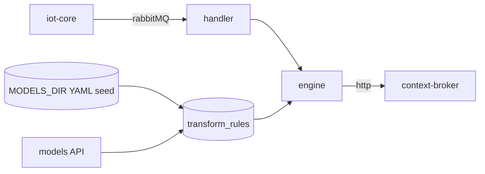

# iot-transform-fiware

A service for handling core functionality in the IoT platform

[](https://github.com/diwise/iot-agent/blob/main/LICENSE)

# Design 



## Dependencies  
 - [iot-device-mgmt](https://github.com/diwise/iot-device-mgmt)
 - [RabbitMQ](https://www.rabbitmq.com/)
 - [Context Broker](https://github.com/diwise/context-broker)

## Modeller
Tjansten ar helt konfigurationsstyrd: mappningen fran matvarden och saker till
[Smart Data Models](https://smartdatamodels.org/) (FIWARE/NGSI-LD) beskrivs i
regler som lagras i postgres (tabell `transform_rules`). YAML-filerna i
`deployments/models/` ar seed som laggs in idempotent vid start och aldrig
skriver over API-andringar; varje API-skrivning laddar om korningsmotorerna
atomart. Reglerna foljer NGSI-LD (`id` och `type` satts alltid) samt
respektive datas `required`-lista; attributnamn foljer modellen.
### AirQualityObserved
[Specification](https://github.com/smart-data-models/dataModel.Environment/blob/master/AirQualityObserved/doc/spec.md)

An observation of air quality conditions at a certain place and time.
### IndoorEnvironmentObserved
[Specification](https://github.com/smart-data-models/dataModel.Environment/blob/master/IndoorEnvironmentObserved/doc/spec.md)

An observation of air and climate conditions for indoor environments.
### GreenspaceRecord
[Specification](https://github.com/smart-data-models/dataModel.ParksAndGardens/blob/master/GreenspaceRecord/doc/spec.md)

This entity contains a harmonised description of the conditions recorded on a particular area or point inside a greenspace (flower bed, garden, etc.).
### Device
[Specification](https://github.com/smart-data-models/dataModel.Device/blob/master/Device/doc/spec.md)

An apparatus (hardware + software + firmware) intended to accomplish a particular task (sensing the environment, actuating, etc.).
### Lifebuoy
[Specification]()

Custom Smart Data Model
### WeatherObserved
[Specification](https://github.com/smart-data-models/dataModel.Weather/blob/master/WeatherObserved/doc/spec.md)

An observation of weather conditions at a certain place and time. This data model has been developed in cooperation with mobile operators and the GSMA.
### WaterQualityObserved
[Specification](https://github.com/smart-data-models/dataModel.WaterQuality/blob/master/WaterQualityObserved/doc/spec.md)

Water Quality data model is intended to represent water quality parameters at a certain water mass (river, lake, sea, etc.) section
### WaterConsumptionObserved
[Specification](https://github.com/smart-data-models/dataModel.WaterConsumption/blob/master/WaterConsumptionObserved/doc/spec.md) 

 The Smart Water Meter model captures water consumption, customer side leak alarms and associated flow rate originating from the smart water meters

## Things

### Sewers
...

# Build and test
## Build
```bash
docker build -f deployments/Dockerfile . -t diwise/iot-transform-fiware:latest
```
## Test
Testing is best done using unit tests. For integration testing the preferred way is to use `docker-compose.yaml` found in repository [diwise](https://github.com/diwise/diwise) 

# Configuration

## Environment variables

```json
"RABBITMQ_HOST": "<rabbit mq hostname>"
"RABBITMQ_PORT": "5672"
"RABBITMQ_VHOST": "/"
"RABBITMQ_USER": "user"
"RABBITMQ_PASS": "bitnami"
"RABBITMQ_DISABLED": "false"
"NGSI_CB_URL":"<http://context-broker>"
```
## CLI flags
 - `loglevel` - Set the log level (overrides `LOG_LEVEL`)

## Regel-API (`SERVICE_PORT`, OPA-skyddat)

Publikt CRUD + validering + torr forhandsgranskning under `/api/v0/models`
(kontrakt: `assets/docs/openapi.yaml`; kroppar ar `application/json`, okanda
falt nekas). Scopes `transforms.read/create/update/delete`
(`transforms.create` laggs till i compose-policyn; ovriga finns dar).
Skrivning kraver `If-Match` med revision (`"rev-<n>"`, 409 vid konflikt);
`PUT` flippar kallan till `api` sa att seed aldrig skriver over manuella
andringar. `POST /models/preview` kor en inline-regel torrt mot en
exempelhandelse (aldrig broker/persistens).

## Generell SDM-mappning (bada kallor)

Motorn ar delad, sa konstruktionerna nedan fungerar for bade matvarden och
things-v2-handelser; kall-specifikt ar endast adaptrarna och valideringens
kind-kontroller:

- `Geo` tar GeoJSON (`Point`/`LineString`/`Polygon`/`MultiPoint`/
  `MultiLineString`/`MultiPolygon` med numeriska koordinater) via
  `field:`/`value:`/`const:`; `latlon:`-vagen ar oforandrad.
- `LanguageMap` skriver `LanguageProperty` (`field:` mot strangmapp eller
  `const:` med mapp; tom mapp = saknad kalla). `transform`/`derive`
  avvisas pa `LanguageMap` i v1.
- `observedAt` hedras pa `Boolean`, `Geo` och `Relationship` vid explicit
  konfigurering (utan config ar output oforandrad).
- Kallbackning per kind: `resource`/`object`/`env`/`name` forbjuds pa
  thing-regler, `field`/`ref` pa matvardesregler (galler aven `Derive.Of`
  och subproperties); `LanguageMap` kraver `field` eller `const`.
- Things-adaptern bevarar icke-punkt-geometri som `fields["geometry"]`
  (ra GeoJSON-mapp) och exponerar `fields["metadata"]`
  (`field:metadata.<nyckel>`); `fields["location"]` ar oforandrad
  (latlon-mapp for punkter).

Medvetet utanfor i v1: `VocabProperty`, struktur-arrayer,
`BooleanArray`/`DateTimeArray`, `datasetId`, `observedBy` utanfor Number
(biblioteksbegransning).

## Regelsynk mellan instanser

Varje mutation bumpar en global versionsraknare i samma transaktion.
Instanser laggar regler + version i en oforanderlig snapshot som byts
atomart (saker och matvarden ser aldrig olika versioner) och pollar
versionen var 5:e sekund: alla instanser konvergerar utan omstart.
Misslyckad omladdning ger 500 pa anropet men nasta synk laker.

## Auktoriseringsmodell (tenant-ägarskap)

En regels ägare är dess `match.tenant`; tom tenant betyder global
(seed-ägd) regel. Läsning visar globala regler samt regler för egna
auktoriserade tenants — övrigt ger 404 utan existensläcka. Skrivning
kräver icke-tom tenant inom egna auktoriserade tenants; globala regler
administreras via seed-filer och ger 403 via API. `match.tenant` är ett
matchningsvillkor, inte i sig auktorisering — ägarskapet upprätthålls i
handlers, lagret är tenant-okunnigt med flit.

## Configuration files
Modeller seedas fran `MODELS_DIR` (`/opt/diwise/config/models`) i
lexikografisk filnamnsordning vid start (stabil nyckel `<fil>#<index>`;
redigerade seed-filer uppdaterar seed-rader, API-agda rader skippas).
Strikt avkodning och validering stoppar starten vid fel. Exempel finns i
`deployments/models/`.

## Faktisk konfiguration (kod ar facit, HARM-002)
Precedens: default < miljovariabel < CLI-flagga. RabbitMQ konfigureras i ovrigt via `messaging.LoadConfiguration`.

| Variabel | Default | Notering |
| --- | --- | --- |
| `LISTEN_ADDRESS` | `0.0.0.0` | Galler bada servrarna |
| `CONTROL_PORT` | `8000` | Kontrollserver: pprof, liveness, `rabbitmq`-stubb som returnerar OK |
| `SERVICE_PORT` | `8080` | Publik server: regel-API:t (`/api/v0/models`, OPA-skyddat) |
| `NGSI_CB_URL` | `http://context-broker` |  |
| `OAUTH2_TOKEN_URL` | (tom) | Utan fullstandiga OAuth-uppgifter skapas context-broker-klient utan token |
| `OAUTH2_CLIENT_ID` | (tom) |  |
| `OAUTH2_CLIENT_SECRET` | (tom) |  |
| `OAUTH2_REALM_INSECURE` | `true` | Endast exakt `true` stanger av TLS-verifiering |
| `LOG_LEVEL` | `debug` | Enda CLI-flaggan ar `-loglevel` |
| `MODELS_DIR` | `/opt/diwise/config/models` | YAML-seed, lases idempotent vid start (aldrig overskrivning av API-rader) |
| `POLICIES_FILE` | `/opt/diwise/config/authz.rego` | OPA-policy for regel-API:t |
| `AUTHZ_ACCESS_OBJECT_ENABLED` | `true` | Access-objekt med per-tenant scopes; `false` för legacy `tenants`-policyer |
| `POSTGRES_HOST` | (tom, kravs) | Regel­lagring kraver PostgreSQL (enda backend) |
| `POSTGRES_PORT` | `5432` |  |
| `POSTGRES_DBNAME` | `diwise` |  |
| `POSTGRES_USER` | (tom) |  |
| `POSTGRES_PASSWORD` | (tom) |  |
| `POSTGRES_SSLMODE` | `disable` |  |
| `DEV_MGMT_URL` | `http://iot-device-mgmt` | Anvands for att sla upp enhets sensortyp (med TTL-cache) |
| `DEFAULT_CONTEXT_URL` | diwise default-context | JSON-LD-context som fallback nar en entitet inte anger `context` |
| `RABBITMQ_HOST` | (tom, kravs om inte avstangd) | Se `messaging.LoadConfiguration` |
| `RABBITMQ_PORT` | `5672` |  |
| `RABBITMQ_VHOST` | `/` |  |
| `RABBITMQ_USER` | `user` |  |
| `RABBITMQ_PASS` | `bitnami` |  |
| `RABBITMQ_DISABLED` | `false` |  |
| `RABBITMQ_INIT_TIMEOUT` | `10` | Sekunder |
| `THINGS_V1_VALUES` | `false` | Endast exakt `true` prenumererar pa versionerade sakhandelser (`things.v1.values`, `things.v1.relations` och `things.v1.lifecycle`, E7). Samma motor/modeller; handelsekallan (`match.event`) skiljer reglerna at |

Health paths pa kontrollservern (`CONTROL_PORT`): `/health`, `/healthz`, `/livez`, `/readyz`, `/readyz/{check}`.

Konsumerar `message.accepted` (en handler per topic; matchning sker pa innehall) samt, nar `THINGS_V1_VALUES=true`, `things.v1.values` (versionerade vardesevent med `values.<egenskap>.*`-vagar; regler avgransas med `match.event: things.v1.values`, se `deployments/models/90-*.yaml`), `things.v1.relations` (partOf set/removed med from/to-descriptors; regler avgransas med `match.event` + `match.relation`/`match.relationRemoved`, se `deployments/models/94-relations-things-v1.yaml`) och `things.v1.lifecycle` (created/updated/deleted; delete-regler raderar entiteten idempotent med `match.lifecycle: deleted`, se `deployments/models/93-lifecycle-things-v1.yaml`). `thing.updated` konsumeras inte langre (legacy thing-regler ersatta av things-v2-regler; topicen publiceras fortsatt for andra konsumenter). Ingen `message.transformed` publiceras i nulaget.

Extern paverkan (BASE-002): imagen exponerar kontrollporten (`EXPOSE 8000`) och den publika porten (`EXPOSE 8080`). Externa Kubernetes- och Compose-definitioner ska anvanda kontrollporten for health-prober och den publika porten for regel-API:t.

Extern paverkan: `SERVICE_PORT` styr den publika servern med regel-API:t (`/api/v0/models`, OPA-skyddat). Compose-definitioner som behovt det tidigare reverserade PILOT-003-beslutet ska satta porten igen.
# Harmoniseringspilot (PILOT-004)

Denna tjanst var pilot for harmoniseringen mot malstrukturen
`cmd/<tjanst>` + `internal/{application,infrastructure,presentation}`.
Slutstruktur:

```text
cmd/iot-transform-fiware
internal/application/{measurements,things,transform}
internal/infrastructure/{config,contextbroker,devicemanagement,rules}
internal/presentation/{api,messaging/{measurements,things}}
```

## Monster att ateranvanda

- Privat `flagType`, `flagMap` och `appConfig` i `cmd`, med precedensen default < env < CLI-flagga.
- `servicerunner` med kontrollserver, liveness och namngivna readiness-stubbar som returnerar OK.
- Felreturnerande `initialize` och felkontrollerad handlerregistrering; endast `main` avgor exitkod.
- Outbound-adaptrar (context-broker-klient, OAuth-fabrik, merge/create) i `internal/infrastructure`.
- Inkommande RabbitMQ-adaptrar i `internal/presentation/messaging`: envelopeavkodning och brokeranrop. Den konfigurationsstyrda motorn och domänmodellen ligger i `internal/application/transform`, medan `internal/infrastructure/config` laddar och validerar modellerna.
- Karakteriseringstester for kontrakt, config och lifecycle; verifiering med `gofmt`, `go test ./...`, `go vet ./...`, `go build ./cmd/...` och Dockerbygge.

## Att inte kopiera

- Presentation far importera bade `internal/application` och `internal/infrastructure`; `internal/application` far inte importera `internal/infrastructure`.

# Links
[iot-transform-fiware](https://diwise.github.io/) on diwise.github.io
