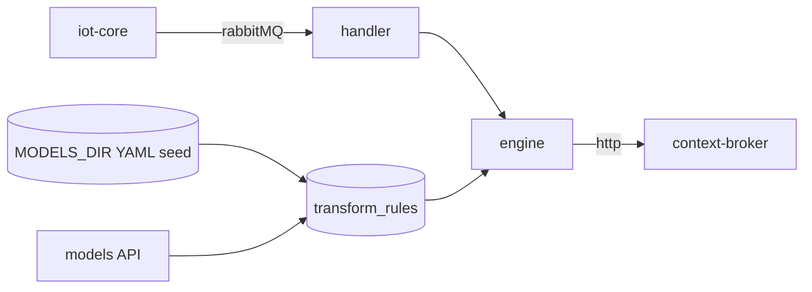

# iot-transform-fiware

A service for handling core functionality in the IoT platform

[](https://github.com/diwise/iot-agent/blob/main/LICENSE)

# Design 



## Dependencies  
 - [iot-device-mgmt](https://github.com/diwise/iot-device-mgmt)
 - [RabbitMQ](https://www.rabbitmq.com/)
 - [Context Broker](https://github.com/diwise/context-broker)

## Modeller
Tjansten ar helt konfigurationsstyrd: mappningen fran matvarden och saker till
[Smart Data Models](https://smartdatamodels.org/) (FIWARE/NGSI-LD) beskrivs i
regler som lagras i postgres (tabell `transform_rules`). YAML-filerna i
`deployments/models/` ar seed som laggs in idempotent vid start och aldrig
skriver over API-andringar; varje API-skrivning laddar om korningsmotorerna
atomart. Reglerna foljer NGSI-LD (`id` och `type` satts alltid) samt
respektive datas `required`-lista; attributnamn foljer modellen.
### AirQualityObserved
[Specification](https://github.com/smart-data-models/dataModel.Environment/blob/master/AirQualityObserved/doc/spec.md)

An observation of air quality conditions at a certain place and time.
### IndoorEnvironmentObserved
[Specification](https://github.com/smart-data-models/dataModel.Environment/blob/master/IndoorEnvironmentObserved/doc/spec.md)

An observation of air and climate conditions for indoor environments.
### GreenspaceRecord
[Specification](https://github.com/smart-data-models/dataModel.ParksAndGardens/blob/master/GreenspaceRecord/doc/spec.md)

This entity contains a harmonised description of the conditions recorded on a particular area or point inside a greenspace (flower bed, garden, etc.).
### Device
[Specification](https://github.com/smart-data-models/dataModel.Device/blob/master/Device/doc/spec.md)

An apparatus (hardware + software + firmware) intended to accomplish a particular task (sensing the environment, actuating, etc.).
### Lifebuoy
[Specification]()

Custom Smart Data Model
### WeatherObserved
[Specification](https://github.com/smart-data-models/dataModel.Weather/blob/master/WeatherObserved/doc/spec.md)

An observation of weather conditions at a certain place and time. This data model has been developed in cooperation with mobile operators and the GSMA.
### WaterQualityObserved
[Specification](https://github.com/smart-data-models/dataModel.WaterQuality/blob/master/WaterQualityObserved/doc/spec.md)

Water Quality data model is intended to represent water quality parameters at a certain water mass (river, lake, sea, etc.) section
### WaterConsumptionObserved
[Specification](https://github.com/smart-data-models/dataModel.WaterConsumption/blob/master/WaterConsumptionObserved/doc/spec.md) 

 The Smart Water Meter model captures water consumption, customer side leak alarms and associated flow rate originating from the smart water meters

## Things

### Sewers
...

# Build and test
## Build
```bash
docker build -f deployments/Dockerfile . -t diwise/iot-transform-fiware:latest
```
## Test
Testing is best done using unit tests. For integration testing the preferred way is to use `docker-compose.yaml` found in repository [diwise](https://github.com/diwise/diwise) 

# Configuration

## Environment variables

```json
"RABBITMQ_HOST": "<rabbit mq hostname>"
"RABBITMQ_PORT": "5672"
"RABBITMQ_VHOST": "/"
"RABBITMQ_USER": "user"
"RABBITMQ_PASS": "bitnami"
"RABBITMQ_DISABLED": "false"
"NGSI_CB_URL":"<http://context-broker>"
```
## CLI flags
 - `loglevel` - Set the log level (overrides `LOG_LEVEL`)

## Regel-API (`SERVICE_PORT`, OPA-skyddat)

Publikt CRUD + validering + torr forhandsgranskning under `/api/v0/models`
(kontrakt: `assets/docs/openapi.yaml`; kroppar ar `application/json`, okanda
falt nekas). Scopes `transforms.read/create/update/delete`
(`transforms.create` laggs till i compose-policyn; ovriga finns dar).
Skrivning kraver `If-Match` med revision (`"rev-<n>"`, 409 vid konflikt);
`PUT` flippar kallan till `api` sa att seed aldrig skriver over manuella
andringar. `POST /models/preview` kor en inline-regel torrt mot en
exempelhandelse (aldrig broker/persistens).

## Generell SDM-mappning (bada kallor)

### Identitet och mallfält

Använd normalt `id: "urn:ngsi-ld:<Modell>:{{id}}"`. `id` är sakens
oförändrade `thingId` för things-event och enhetens `deviceID` för
measurements. En befintlig GUID/UUID bevaras; motorn skapar ingen ny identitet.
Namn hör till attribut, exempelvis `{ target: name, type: Text, value: "{{name}}", observedAt: none }`.
`nameOrID` finns inte längre som genväg eller implicit fallback.

`{{fält}}` kan läsa vilket exponerat källfält som helst, även nästlat:
`{{metadata.description}}`, `{{values."temperature.average".value}}` och
`{{relation.to.thingId}}`. `field:` är ett valfritt explicit prefix för samma
uppslag. Kända identitets-/metadatavariabler har företräde framför dynamiska
fält. Funktionerna `safeURI(...)` och `firstPresent(...)` fungerar även med
dessa fältvägar. Objekt och listor renderas som JSON, tal och booleska värden
som JSON-skalärer, strängar som rå text.

Validering kontrollerar syntax, funktionsargument och entitetsreferenser.
Den avvisar även ogiltiga statiska ID-/relations-URI:er, context-URL:er,
DateTime-värden och konstanta värdetyper/resultat. Transformargument måste
vara finita och division med noll avvisas även när värdekällan är dynamisk.
Samma validering används vid YAML/seed, API, snapshot och offline-preview;
kontrollerna är generella och känner inte till standardreglernas modellval.
Regeluppsättningar tillåter samma ID-mall med olika måltyper i åtskilda tenants
eller åtskilda matchningar. Olika typmallar för samma ID-mall avvisas inom
samma regel eller mellan potentiellt överlappande regler. En global regel
kan överlappa en tenantspecifik regel; olika resursvillkor kan överlappa när
en observation innehåller båda resurserna. Kontrollens statiska gränser
beskrivs i `assets/docs/transform-contract.md`.
Dynamiska fälts närvaro kan bara avgöras mot exempeldata eller ett verkligt
event. Saknat fält ger ett klassificerbart källfel; `firstPresent` kan ange
en uttrycklig fallback. Namnbaserade ID:n kräver ett uttryckligt regelval;
regelns författare ansvarar då för namnbyten, kollisioner och tidigare mål.
Motorn lagrar inte tidigare mål-ID:n eller städar dem automatiskt. Samma
ansvar gäller om man uttryckligen ändrar ID-mall eller modellprefix.

Relationsregler använder exempelvis
`value: "urn:ngsi-ld:WaterQualityObserved:{{relation.from.thingId}}"` med
`type: Relationship, array: true`. Descriptors i `relation.from` och
`relation.to` innehåller råa ID:n och namn, ingen förbyggd modell-URN.
`array: true` gör skalären till en lista och bevarar befintliga listor platta;
flerrelationsaggregation ingår inte. Både skalärer och listelement måste vara
absoluta URI-strängar.

### Sensorportar

En fysisk anslutning/utgång på sensorn anges före objektet i SenML-namnet:

- Utan port: `123-456-789/3303/5700` → `port: ""`.
- Med port: `123-456-789/2/3303/5700` → `port: "2"`.
- `123-456-789/0/3303/5700` → explicit port `"0"`, inte portlös.

`match.port: "2"` avgränsar regeln till just den anslutningen. Tomt/osatt
`match.port` är wildcard och matchar även portlösa observationer. `{{port}}`
exponerar portsträngen och en portspecifik regel vinner över en i övrigt
likadan generell regel. Porten hämtas från den partitionerade observationens
header; olika portar får inte dela värden eller mättider. Radioport och rå
Channel-metadata används inte för att gissa fysisk port.

### Borttagna mallar

Greenhouse/tank-mallarna är borttagna i väntan på nya mallar; ingen
AgriGreenhouse- eller tank-WaterQualityObserved-regel levereras tills vidare.

### Standardregler (PLAN1050 J2)

Beslut efter neutral acceptans (J1); motorn/adaptrarna är generella
(inga modellnamn), valen ligger i regler och modelltester
(`internal/infrastructure/config/j2_standard_test.go`):

- `dateObserved` (`timestamp: true`) är max-observedAt (mättid), aldrig
  publiceringstid; fallback publiceringstid endast för deskriptor-bara event.
  `{{timestamp}}` och `timestamp: true` är därmed samma konsumenttid.
- Lifecycle `created`/`updated` skapar beskrivande skal (namn/plats/
  beskrivning + händelsetid) utan mätningar, med samma mål-ID:n som
  värde-reglerna; mätburna entiteter (WeatherObserved/WaterQualityObserved)
  tillkommer vid första värdeseventet. Saknad källa är skip, aldrig rensning.
- Rums `partOf`→`refParent` är hårdkodad Building-URN med
  `match.toType: building`; andra måltyper ger no-match (skip utan
  brokerkontakt). Fler måltyper kräver nya regler med egen toType + URN-mall.
- Sewer kräver plats/tid (skärpt); `overflowTime` och `refDevice` mappas inte
  (ingen v2-källa) — dokumenterade avsteg, entiteten skrivs utan dem.
- Greenhouse/tank-regler förblir borttagna; mallar utan regler är avsiktligt.
- Plats läses via `field: geometry` (rå GeoJSON för Point/Polygon/3D);
  Point-genvägen `location` döljer aldrig övriga geometrier.
- Relationsidentiteten är
  `v1/<tenant>/<from>/relations/<typ>/<to>/<revision>/<set|removed>`
  (To för unicitet vid flera mål; paritet med producenten). Legacy v1 utan
  To förblir läsbar (ingen To-kontroll); icke-v1 nekas strikt i F medan
  C1 läser tolerant opakt.
- Specificitet räknas enkelt: `thingTypeVersion`/`variantId`/`variantVersion`
  ger +1 vardera i både `score()` (körning) och `specificityD()`
  (kompatibilitet).

Motorn ar delad, sa konstruktionerna nedan fungerar for bade matvarden och
things-v2-handelser; kall-specifikt ar endast adaptrarna och valideringens
kind-kontroller:

- `Geo` tar GeoJSON (`Point`/`LineString`/`Polygon`/`MultiPoint`/
  `MultiLineString`/`MultiPolygon` med numeriska koordinater) via
  `field:`/`value:`/`const:` eller `latlon:`. Alla koordinatkällor använder
  regelns `target`, även utan explicit observationstid.
- `LanguageMap` skriver `LanguageProperty` (`field:` mot strangmapp eller
  `const:` med mapp; tom mapp = saknad kalla). `transform`/`derive`
  avvisas pa `LanguageMap` i v1.
- `observedAt` stöds konsekvent på samtliga attributtyper.
- Kallbackning per kind: `resource`/`object`/`env`/`name` forbjuds pa
  thing-regler, `field`/`ref` pa matvardesregler (galler aven `Derive.Of`
  och subproperties); `LanguageMap` kraver `field` eller `const`.
- Vanliga properties, `derive.of` och Structured-delvärden delar
  källutvärdering: även `const`, `value`, `latlon` och `timestamp` fungerar
  som aggregatingångar. `object`/`env` kräver `resource` eller `name`.
  Ingångens `prefix` används före aggregatet; propertyns prefix efteråt.
  Prefix kräver text eller en lista med enbart text.
- Regelns `priority` (default 0, även negativ tillåts) väger före specificitet
  och stabil ordning. Env och port ger båda specificitetspoäng.
  `match.toType` avgränsar relationens råa måltyp; lifecycle kräver explicit
  created/updated/deleted. Device-filter avvisas för things.
- Saknad/null/tom text, lista eller mapp ger ingen skrivning. Noll och false
  är närvarande. Required undertrycker entiteten; tom Structured och aggregat
  utan ingångar skriver inte. Alla närvarande aggregatingångars typer prövas
  utan att fel ignoreras. Measurement-broker/token förbereds först efter att
  transformationen producerat skrivningar.
- Default `observedAt` följer värdets egen observationstid, med measurement-
  header som fallback. Konstanter och namn får ingen implicit tid. `record`,
  `header`, `message`, `field:<väg>` och `none` väljer tid explicit och fungerar
  på alla attributtyper. Källvyer bevarar RFC3339Nano; broker-utdata
  (DateTime-värden och observedAt) trunkeras till millisekunder (Orion avvisar
  nanosekunder). `timestamp: true` för
  values-event är max-observedAt (mättid; J2), med publiceringstid som fallback
  endast när inga värdetider finns; `{{timestamp}}` är samma konsumenttid.
  `event.publishedAt` förblir explicit valbar via mall för diagnostik.
- Kända källenheter får inte märkas om utan ekvivalent kod eller explicit
  `convert: {from: Cel, to: KEL, offset: 273.15}`. Factor default 1, offset
  default 0; omvandlingen sker före transform och stöder Number/NumberArray.
  Författaren ansvarar för fysisk korrekthet. Se enhets- och tidstabeller i
  `assets/docs/transform-contract.md` för detaljer och avgränsningar.
- Structured-delvärden konverteras till deklarerad typ efter transform/prefix,
  och kan använda `derive`. De är råa JSON-värden, inte nästlade NGSI-LD-attribut:
  `unit`, `observedAt`, `observedBy`, `array` och nästlad Structured avvisas.
  Attributets egen observedAt stöds även för Structured och DateTime.
- Validerings- och körningsfel anger regel, entitet och relevant
  attribut-/uttryckskontext. Potentiella regelöverlapp och faktiskt skuggade
  measurement-matchningar loggas på debug med regel-ID och snapshotversion.
  Aktiv preview-diagnostik beskrivs separat i `TRANSFORM.md` etapp 8.
- Motor, preview och brokerskrivare validerar faktisk serialiserad NGSI-LD-JSON
  med samma grundprofil. ID/typ/attribut, metadata, datum, finita tal och URI-
  referenser kontrolleras; hela batchen prövas före första brokeroperationen.
  Effektiv context kontrolleras också före broker/tokenförberedelse.
- GeoJSON kräver faktiska numeriska 2D/3D-koordinater med konsekvent dimension,
  WGS84 lon/lat-intervall och rätt nästling/minsta storlek/slutna polygonringar.
  Topologi, context-expansion och full ETSI-/SDM-konformitet ingår inte.
  Profil och begränsningar finns i `assets/docs/transform-contract.md`.
- Things-adaptrarna delar descriptorvy för values, lifecycle och relationer:
  `thing` respektive `relation.from`/`relation.to`. `geometry` bevarar rå
  GeoJSON för både Point, Polygon och 3D; `location` är Point-genvägen.
  Standardreglerna läser plats via `field: geometry` så att alla
  geometrityper mappas (J2). Metadata, kategori och variantfält är åtkomliga
  även för lifecycle.
- Kuvertmetadata finns under `event`. Skrivbara `values.<propertyId>` bär
  hela proveniensen inklusive messageId och separata källtider.
  `observations[]` exponerar samtliga observationers kvalitet/proveniens,
  men inga värden; invalid/null får aldrig kringgå values-vyns kvalitetsgrind.
- Measurements exponerar `{{records[0].fullName}}`, `{{records[0].unit}}`,
  `{{records[0].value}}` och `{{records[0].observedAt}}`, samt
  `message.timestamp`, `header.observedAt` och effektiv `source`.
  Partitionering delar parserns effektiva observationsmetadata med preview,
  så även upprepade objektprefix får rätt env, koordinater och resurser.
  Råa tidsvägar (källvyer) bevarar tillgänglig subsekundprecision;
  broker-utdata trunkeras till millisekunder.

Medvetet utanfor i v1: `VocabProperty`, struktur-arrayer,
`BooleanArray`/`DateTimeArray`, `datasetId`, `observedBy` utanfor Number
(biblioteksbegransning).

## Regelsynk mellan instanser

Varje mutation bumpar en global versionsraknare i samma transaktion.
Instanser laggar regler + version i en oforanderlig snapshot som byts
atomart (saker och matvarden ser aldrig olika versioner) och pollar
versionen var 5:e sekund: alla instanser konvergerar utan omstart.
Misslyckad omladdning ger 500 pa anropet men nasta synk laker.

## Auktoriseringsmodell (tenant-ägarskap)

En regels ägare är dess `match.tenant`; tom tenant betyder global
(seed-ägd) regel. Läsning visar globala regler samt regler för egna
auktoriserade tenants — övrigt ger 404 utan existensläcka. Skrivning
kräver icke-tom tenant inom egna auktoriserade tenants; globala regler
administreras via seed-filer och ger 403 via API. `match.tenant` är ett
matchningsvillkor, inte i sig auktorisering — ägarskapet upprätthålls i
handlers, lagret är tenant-okunnigt med flit.

### Broker- och tokenbudgetar

- `NGSI_CB_TIMEOUT`: positiv Go-duration, default `10s` per brokeroperation.
- `OAUTH2_TOKEN_TIMEOUT`: positiv Go-duration, default `5s` för token/refresh-väntan.

Token och broker använder meddelandets context; klienter och token-cache
återanvänds. HTTP 207 med misslyckade attribut rapporteras med delutfall,
inte som full framgång. Handlerklassificering, HTTP-operationsprofil och
replay-/DLX-gränser beskrivs i `assets/docs/transform-contract.md` etapp 7.

## Configuration files
Modeller seedas fran `MODELS_DIR` (`/opt/diwise/config/models`) i
lexikografisk filnamnsordning vid start (stabil nyckel `<fil>#<index>`;
redigerade seed-filer uppdaterar seed-rader, API-agda rader skippas).
Strikt avkodning och validering stoppar starten vid fel. Exempel finns i
`deployments/models/`.

## Faktisk konfiguration (kod ar facit, HARM-002)
Precedens: default < miljovariabel < CLI-flagga. RabbitMQ konfigureras i ovrigt via `messaging.LoadConfiguration`.

| Variabel | Default | Notering |
| --- | --- | --- |
| `LISTEN_ADDRESS` | `0.0.0.0` | Galler bada servrarna |
| `CONTROL_PORT` | `8000` | Kontrollserver: pprof, liveness, `rabbitmq`-stubb som returnerar OK |
| `SERVICE_PORT` | `8080` | Publik server: regel-API:t (`/api/v0/models`, OPA-skyddat) |
| `NGSI_CB_URL` | `http://context-broker` |  |
| `OAUTH2_TOKEN_URL` | (tom) | Utan fullstandiga OAuth-uppgifter skapas context-broker-klient utan token |
| `OAUTH2_CLIENT_ID` | (tom) |  |
| `OAUTH2_CLIENT_SECRET` | (tom) |  |
| `OAUTH2_REALM_INSECURE` | `true` | Endast exakt `true` stanger av TLS-verifiering |
| `LOG_LEVEL` | `debug` | Enda CLI-flaggan ar `-loglevel` |
| `MODELS_DIR` | `/opt/diwise/config/models` | YAML-seed, lases idempotent vid start (aldrig overskrivning av API-rader) |
| `POLICIES_FILE` | `/opt/diwise/config/authz.rego` | OPA-policy for regel-API:t |
| `AUTHZ_ACCESS_OBJECT_ENABLED` | `true` | Access-objekt med per-tenant scopes; `false` för legacy `tenants`-policyer |
| `POSTGRES_HOST` | (tom, kravs) | Regel­lagring kraver PostgreSQL (enda backend) |
| `POSTGRES_PORT` | `5432` |  |
| `POSTGRES_DBNAME` | `diwise` |  |
| `POSTGRES_USER` | (tom) |  |
| `POSTGRES_PASSWORD` | (tom) |  |
| `POSTGRES_SSLMODE` | `disable` |  |
| `DEV_MGMT_URL` | `http://iot-device-mgmt` | Anvands for att sla upp enhets sensortyp (med TTL-cache) |
| `DEFAULT_CONTEXT_URL` | diwise default-context | JSON-LD-context som fallback nar en entitet inte anger `context` |
| `RABBITMQ_HOST` | (tom, kravs om inte avstangd) | Se `messaging.LoadConfiguration` |
| `RABBITMQ_PORT` | `5672` |  |
| `RABBITMQ_VHOST` | `/` |  |
| `RABBITMQ_USER` | `user` |  |
| `RABBITMQ_PASS` | `bitnami` |  |
| `RABBITMQ_DISABLED` | `false` |  |
| `RABBITMQ_INIT_TIMEOUT` | `10` | Sekunder |
| `THINGS_V1_VALUES` | `false` | Endast exakt `true` prenumererar pa versionerade sakhandelser (`things.v1.values`, `things.v1.relations` och `things.v1.lifecycle`, E7). Samma motor/modeller; handelsekallan (`match.event`) skiljer reglerna at |

Health paths pa kontrollservern (`CONTROL_PORT`): `/health`, `/healthz`, `/livez`, `/readyz`, `/readyz/{check}`.

Konsumerar `message.accepted` (en handler per topic; matchning sker pa innehall) samt, nar `THINGS_V1_VALUES=true`, `things.v1.values` (versionerade vardesevent med `values.<egenskap>.*`-vagar; regler avgransas med `match.event: things.v1.values`, se `deployments/models/90-*.yaml`), `things.v1.relations` (partOf set/removed med from/to-descriptors; regler avgransas med `match.event` + `match.relation`/`match.relationRemoved` + `match.toType`, se `deployments/models/94-relations-things-v1.yaml`) och `things.v1.lifecycle` (created/updated skapar beskrivande skal utan matningar, deleted raderar entiteten idempotent; avgransas med `match.lifecycle`, se `deployments/models/93-lifecycle-things-v1.yaml`). Relations/lifecycle-handlers persisterar F:s neutrala projektion + väntande brokerarbete atomärt (delad pool via `NewForPool`, schema via migration 005/`EnsureSchema`) och dräneras via `DrainOnce` direkt samt av en bakgrunds-Worker (sista dränering inom stoppbudget vid shutdown). `thing.updated` konsumeras inte langre (legacy thing-regler ersatta av things-v2-regler; topicen publiceras fortsatt for andra konsumenter). Ingen `message.transformed` publiceras i nulaget.

Extern paverkan (BASE-002): imagen exponerar kontrollporten (`EXPOSE 8000`) och den publika porten (`EXPOSE 8080`). Externa Kubernetes- och Compose-definitioner ska anvanda kontrollporten for health-prober och den publika porten for regel-API:t.

Extern paverkan: `SERVICE_PORT` styr den publika servern med regel-API:t (`/api/v0/models`, OPA-skyddat). Compose-definitioner som behovt det tidigare reverserade PILOT-003-beslutet ska satta porten igen.
# Harmoniseringspilot (PILOT-004)

Denna tjanst var pilot for harmoniseringen mot malstrukturen
`cmd/<tjanst>` + `internal/{application,infrastructure,presentation}`.
Slutstruktur:

```text
cmd/iot-transform-fiware
internal/application/{measurements,things,transform}
internal/application/relations (neutral projektionsdomän, F)
internal/infrastructure/{config,contextbroker,devicemanagement,rules,projection}
internal/presentation/{api,messaging/{measurements,things}}
```

## Monster att ateranvanda

- Privat `flagType`, `flagMap` och `appConfig` i `cmd`, med precedensen default < env < CLI-flagga.
- `servicerunner` med kontrollserver, liveness och namngivna readiness-stubbar som returnerar OK.
- Felreturnerande `initialize` och felkontrollerad handlerregistrering; endast `main` avgor exitkod.
- Outbound-adaptrar (context-broker-klient, OAuth-fabrik, merge/create) i `internal/infrastructure`.
- Inkommande RabbitMQ-adaptrar i `internal/presentation/messaging`: envelopeavkodning och brokeranrop. Den konfigurationsstyrda motorn och domänmodellen ligger i `internal/application/transform`, medan `internal/infrastructure/config` laddar och validerar modellerna.
- Karakteriseringstester for kontrakt, config och lifecycle; verifiering med `gofmt`, `go test ./...`, `go vet ./...`, `go build ./cmd/...` och Dockerbygge.

## Att inte kopiera

- Presentation far importera bade `internal/application` och `internal/infrastructure`; `internal/application` far inte importera `internal/infrastructure`.

# Links
[iot-transform-fiware](https://diwise.github.io/) on diwise.github.io
